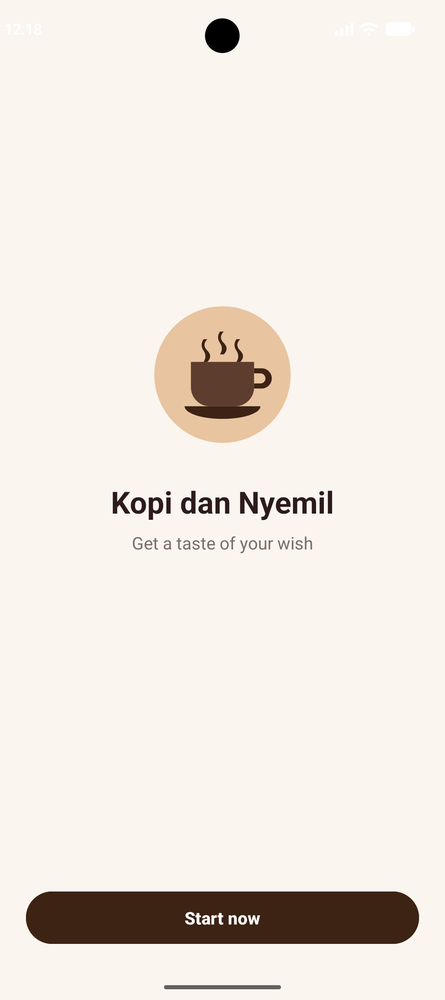
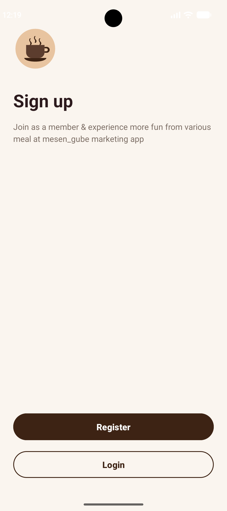
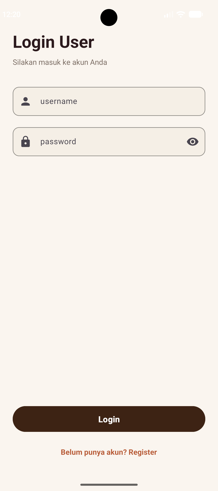
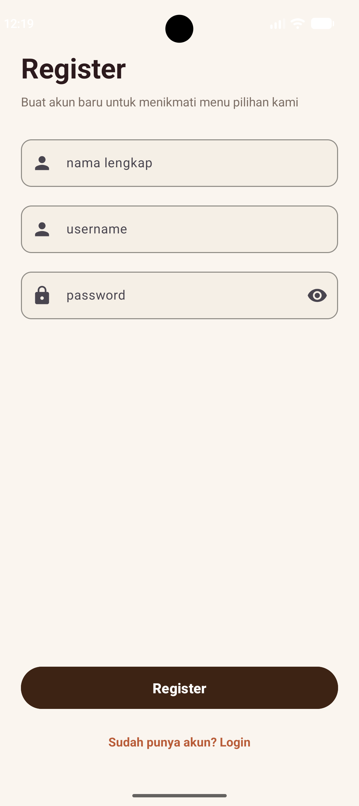
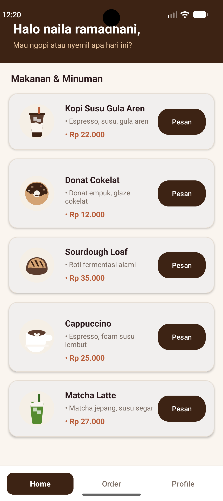
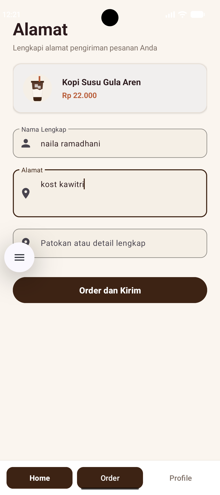
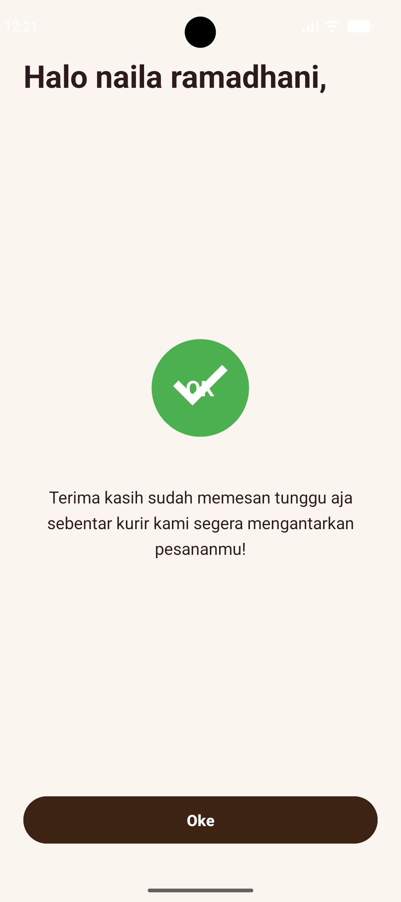
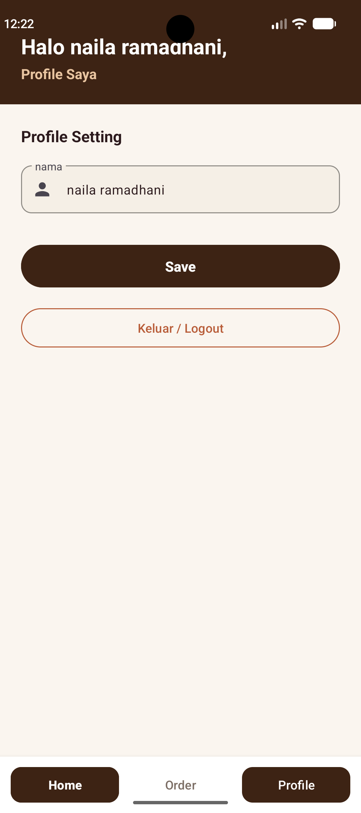

# Kopi dan Nyemil 

Kopi dan Nyemil adalah aplikasi pemesanan kopi dan camilan berbasis Android yang dirancang dengan antarmuka pengguna (UI) modern berkonsep *coffee shop theme*. Aplikasi ini mempermudah pengguna untuk menjelajahi menu favorit, melakukan pendaftaran akun, mengelola profil pengguna, hingga melakukan pengisian alamat pengiriman dan konfirmasi pesanan secara instan.

##  Fitur Utama Aplikasi

1. **Splash / Welcome Screen**
   - Menampilkan logo resmi Kopi dan Nyemil, nama aplikasi, serta tagline "Get a taste of your wish".
   - Mengarahkan pengguna langsung ke alur registrasi/login atau halaman utama jika sudah login.

2. **Pilihan Sign Up / Login Choice**
   - Memberikan opsi navigasi yang jelas bagi pengguna baru (Register) atau pengguna terdaftar (Login).

3. **Register (Pendaftaran Akun)**
   - Form pendaftaran nama lengkap, username, dan password.
   - Validasi input agar tidak ada bidang yang kosong.
   - Menyimpan data akun pengguna secara permanen pada SharedPreferences.

4. **Login User**
   - Form autentikasi menggunakan username dan password.
   - Validasi akun sesuai data terdaftar di *SharedPreferences* (dengan fallback akun tes user / 12345).
   - Menyimpan status login pengguna.

5. **Home (Katalog Menu Produk)**
   - Sapaan personal kepada pengguna (Halo [Nama Pengguna],).
   - Menampilkan daftar produk pilihan menggunakan *RecyclerView* dengan tampilan *CardView* membulat.
   - 5 Produk :
     - **Kopi Susu Gula Aren** — Rp 22.000 (Espresso, susu, gula aren)
     - **Donat Cokelat** — Rp 12.000 (Donat empuk, glaze cokelat)
     - **Sourdough Loaf** — Rp 35.000 (Roti fermentasi alami)
     - **Cappuccino** — Rp 25.000 (Espresso, foam susu lembut)
     - **Matcha Latte** — Rp 27.000 (Matcha jepang, susu segar)
   - Tombol pemesanan produk yang langsung mengarahkan ke halaman Order.
   - *Bottom Navigation Bar* interaktif untuk berpindah antar halaman (Home, Order, Profile).

6. **Profile & Profile Setting**
   - Menampilkan nama pengguna yang sedang aktif.
   - Fitur untuk mengubah nama lengkap secara langsung.
   - Penyimpanan otomatis nama baru ke *SharedPreferences*.
   - Fitur Logout untuk keluar dari sesi akun.

7. **Order & Alamat Pengiriman**
   - Ringkasan produk yang dipilih (nama, harga, gambar).
   - Form pengisian data penerima (*Nama Lengkap*, *Alamat Lengkap*, dan *Patokan / Detail Lokasi*).
   - Pre-fill otomatis nama lengkap dari profil pengguna.
   - Validasi input alamat pengiriman.

8. **Konfirmasi Pesanan**
   - Sapaan hangat kepada pemesan.
   - Indikator status pesanan sukses (*Green Check Circle Badge* "OK").
   - Pesan konfirmasi: *"Terima kasih sudah memesan tunggu aja sebentar kurir kami segera mengantarkan pesananmu!"*.
   - Tombol "Oke" untuk kembali ke halaman utama (*HomeActivity*).

##  Teknologi yang Digunakan

- **IDE**: Android Studio
- **Bahasa Pemrograman**: Kotlin
- **Layout System**: Android XML Layout (ConstraintLayout, LinearLayout, ScrollView, MaterialCardView)
- **UI Components**: Google Material Components (MaterialButton, TextInputLayout, TextInputEditText)
- **List Display**: AndroidX RecyclerView
- **Navigation**: Explicit Intent & Intent Extras / Flags
- **View Binding**: Android Gradle Plugin ViewBinding

##  Cara Menjalankan Proyek di Android Studio

1. **Clone / Open Project**
   - Buka Android Studio.
   - Pilih **File > Open...** lalu pilih folder proyek KopiDanNyemil.

2. **Gradle Sync**
   - Jalankan **Gradle Sync** (biasanya otomatis berjalan saat project dibuka).
   - Pastikan koneksi internet aktif untuk mendownload dependensi AndroidX dan Material Components yang dibutuhkan.

3. **Jalankan pada Emulator / Device**
   - Pilih Virtual Device (Emulator Android dengan min SDK 24 / Android 7.0+) atau HP Android terhubung via USB Debugging.
   - Klik tombol **Run 'app'** (Shift + F10 atau ikon segitiga hijau).
   

## Screenshot Tampilan
### Splash / Welcome

### Sign Up

### Login

### Register

### Home

### Alamat Pengiriman

### Ucapan Terima Kasih

### Profile

